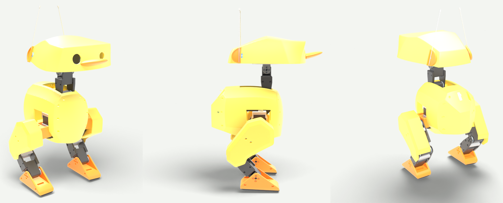
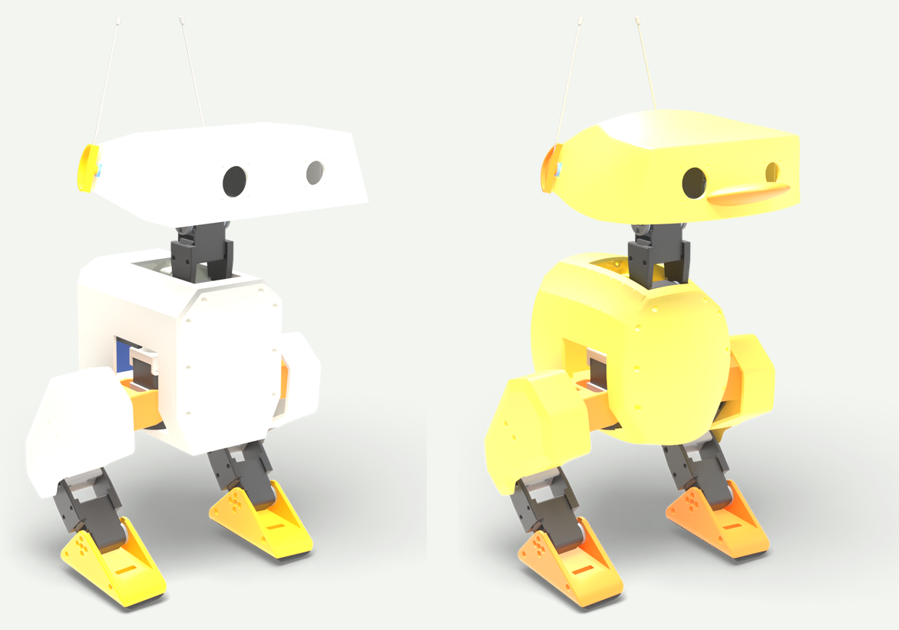

# Open Duck Mini — Duckling

Rounder, duck-shaped shells for the [Open Duck Mini v2](https://github.com/apirrone/Open_Duck_Mini) walking robot: a domed head with a bill, a chubby body and softer thigh covers. They bolt on where the original shells do, and everything inside the robot stays the same.

> **Status: not test-printed yet.** The shells were designed and checked in software only. Print the head first and test-fit it before printing the rest.

## What's here

| Folder | Contents |
|---|---|
| `stl/duckling/` | 11 redesigned parts: head, head bottom plate, two ear caps, five body pieces (including the battery lid) and two thigh covers. They replace the official files of the same name. |
| `stl/bill/` | The bill, glued on the face below the eyes. |
| `stl/original/` | The 25 official parts that don't change, copied from the upstream `print/` folder so the set is complete. |
| `PRINT-LIST.txt` | Every file with quantity, material, infill, colour and size, plus print settings and rough filament amounts. |
| `blender/` | The fully assembled original robot in its standing pose, for Blender. |
| `tools/` | The scripts that made all of this (see [tools/README.md](tools/README.md)). |

## Printing

- PLA at 15% infill for everything, except `foot_bottom_tpu` (TPU at 40%).
- Duckling shells: 3 walls, supports where the slicer asks. The files are in the official print orientation, but the curved ones may print better turned onto another face.
- The biggest part is the head at 216 × 196 × 71 mm, so you need a bed of at least 220 × 200 mm.
- Print `head_duckling.stl` and `head_bot_sheet_duckling.stl` first and check the head sits flush and the screw holes line up.

Colours used in the renders: yellow `#f6dc5a` head and body, deep yellow `#f2c94c` thighs, orange `#f08a24` feet, hips, ear caps and bill, dark grey frame, black TPU soles.

## Will it still walk?

The walking policy was trained in simulation with random changes to part weights, so modest weight changes are fine. Estimates from part volumes:

| Part | Change | Trained range |
|---|---|---|
| Head (with bill) | about +13 g | ±40 g |
| Body | about −75 g | ±100 g |
| Both thigh covers | about −13 g | ±12 g each |

Legs, feet and soles are unchanged. A clearance check against every modelled part inside the robot (frame, battery, Pi, servos) found no collisions; cables aren't modelled, so leave them room.

## How it was made

1. The full robot export was posed in its standing pose with MuJoCo and assembled in Blender.
2. Each group of shells (head, body, each thigh cover) sits in a free-form deformation cage. Moving the cage rounds, domes and fills out the shape while the 2 mm walls keep their thickness and the body pieces still meet at their seams.
3. Wherever a wall would have moved into a part inside, the cage was eased back at that spot only.
4. The head was rebuilt from the current official `head.stl`, which is newer than the head in the robot export.
5. Every part was moved into the official print orientation, checked as a closed solid, and cleaned of sliver triangles.

## Credits and licence

Open Duck Mini is by Antoine Pirrone and contributors, licensed under the [Apache License 2.0](LICENSE). This repository contains unchanged copies of official parts plus modified and new files; see [NOTICE](NOTICE) for what changed. The modifications are released under the same licence.
