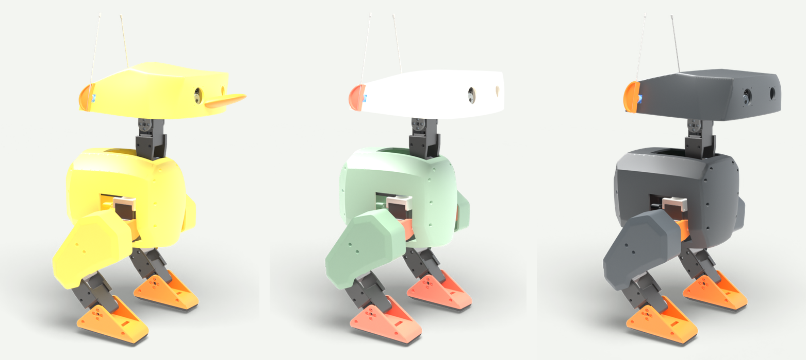
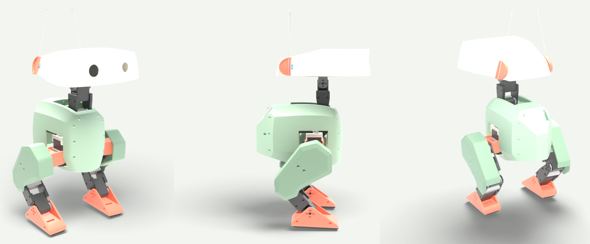
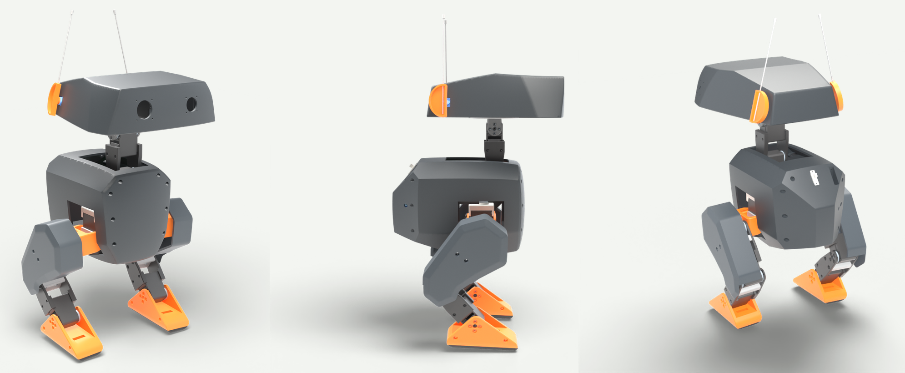
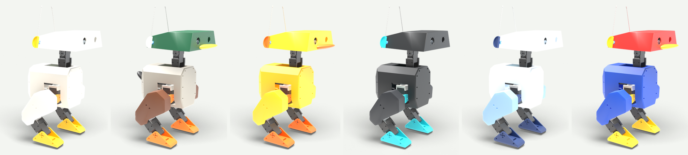

# Open Duck Mini — Duckling (and friends)

New outer shells for the [Open Duck Mini v2](https://github.com/apirrone/Open_Duck_Mini) walking robot. Three reshaped designs (Duckling, Pebble and Visor), six colour schemes for the original parts, and a printable bill and tail. The new shells bolt on where the originals do, and everything inside the robot stays the same.

> **Status: not test-printed yet.** Everything here was designed and checked in software only. Print the head and head plate of your chosen design first and test-fit them before printing the rest.

## The three shapes

| Design | Look | Print list |
|---|---|---|
| **Duckling** | Domed head with a bill, round chubby body | [PRINT-LIST-duckling.txt](PRINT-LIST-duckling.txt) |
| **Pebble** | Soft, pillowy curves on every shell | [PRINT-LIST-pebble.txt](PRINT-LIST-pebble.txt) |
| **Visor** | Angular head that rises at the back, a brow over the eyes, a V-shaped chest | [PRINT-LIST-visor.txt](PRINT-LIST-visor.txt) |

Each design replaces the same 11 parts: the head, the head bottom plate, two ear caps, five body pieces (including the battery lid) and two thigh covers. The print lists give every file to print with quantity, material, colour and size.

## Colour schemes and add-ons

These use the original parts in `stl/original/` plus the official head and body shells from the [upstream print folder](https://github.com/apirrone/Open_Duck_Mini/tree/v2/print); only the filament changes. From left to right:

| Scheme | Head | Body | Thighs | Feet, hips, ear caps | Add-ons |
|---|---|---|---|---|---|
| Classic | `#d6d4cc` | `#d6d4cc` | `#d6d4cc` | `#fab601` (hips `#e89129`) | — |
| Mallard | `#0f5436` | `#a8a399` | `#6b3d24` | `#f5801a` (ear caps `#e6e6e0`) | bill `#edc72e`, tail `#1a1a1c` |
| Rubber Duck | `#fac21a` | `#fac21a` | `#fac21a` | `#f76e0f` | bill `#f76e0f` |
| Midnight | `#1c1f21` | `#1c1f21` | `#292b30` | `#1abdc7` | — |
| Arctic | `#e6f0f7` | `#e6f0f7` | `#8fb5db` | `#21386b` | — |
| Toy Box | `#d6211c` | `#1a4dbd` | `#1a4dbd` | `#fcc714` | bill `#fcc714` |

The add-ons in `stl/addons/` glue on: `duck_bill.stl` (64 × 50 × 19 mm, about 15 g) on the face below the eyes, and `duck_tail.stl` (40 × 33 × 28 mm, about 8 g) on the back of the body. Both print flat side down without supports.

## Printing

- PLA at 15% infill for everything, except `foot_bottom_tpu` (TPU at 40%).
- New shells: 3 walls, supports where the slicer asks. The files are in the official print orientation, but the curved ones may print better turned onto another face.
- The biggest parts are the heads, up to 218 × 202 × 71 mm, so you need a bed of at least 220 × 205 mm.

## Will it still walk?

The walking policy was trained in simulation with random changes to part weights, so modest weight changes are fine. Estimates from part volumes, compared with the official parts:

| Design | Head | Body | Both thigh covers |
|---|---|---|---|
| Duckling | about +12 g (with bill) | about −75 g | about −13 g |
| Pebble | about +5 g | about −100 g | about −10 g |
| Visor | about +20 g | about −15 g | about −10 g |
| *Trained range* | *±40 g* | *±100 g* | *±12 g each* |

Pebble's body is at the edge: tape 60–80 g of steel washers inside the body near the middle, or print its body pieces at 30% infill. Legs, feet and soles are unchanged in every design. A clearance check against every modelled part inside the robot (frame, battery, Pi, servos) found no collisions; cables aren't modelled, so leave them room.

## What's here

| Path | Contents |
|---|---|
| `stl/duckling/`, `stl/pebble/`, `stl/visor/` | The 11 reshaped parts of each design |
| `stl/original/` | The 25 official parts that every design keeps, copied from upstream so each set is complete |
| `stl/addons/` | Bill and tail |
| `PRINT-LIST-*.txt` | One print list per design |
| `blender/` | The fully assembled original robot in its standing pose, for Blender |
| `tools/` | The scripts that made all of this (see [tools/README.md](tools/README.md)) |

## How it was made

1. The full robot export was posed in its standing pose with MuJoCo and assembled in Blender.
2. Each group of shells (head, body, each thigh cover) sits in a free-form deformation cage. Moving the cage rounds, domes and fills out the shape while the 2 mm walls keep their thickness and the body pieces still meet at their seams. The cage's bottom layers don't move vertically, so the head rim and the head plate stay flat.
3. Wherever a wall would have moved into a part inside, the cage was eased back at that spot only.
4. The heads were rebuilt from the current official `head.stl`, which is newer than the head in the robot export.
5. Every part was moved into the official print orientation, checked as a closed solid, and cleaned of sliver triangles.

## Credits and licence

Open Duck Mini is by Antoine Pirrone and contributors, licensed under the [Apache License 2.0](LICENSE). This repository contains unchanged copies of official parts plus modified and new files; see [NOTICE](NOTICE) for what changed. The modifications are released under the same licence.
